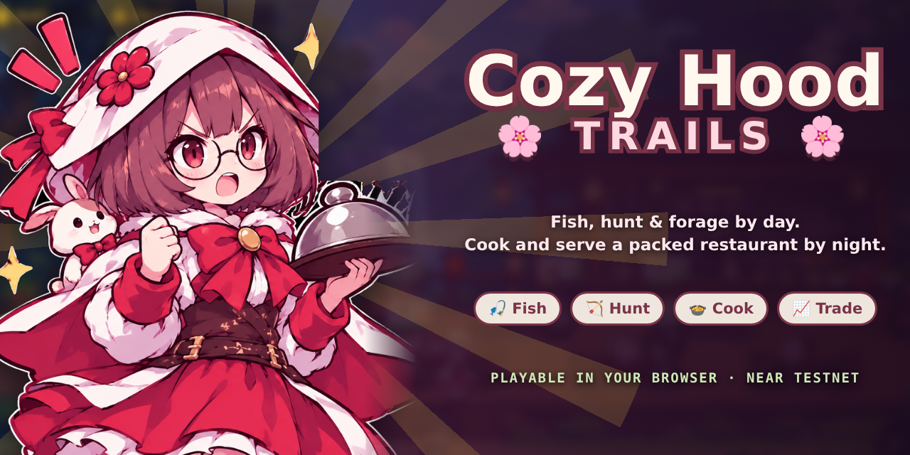
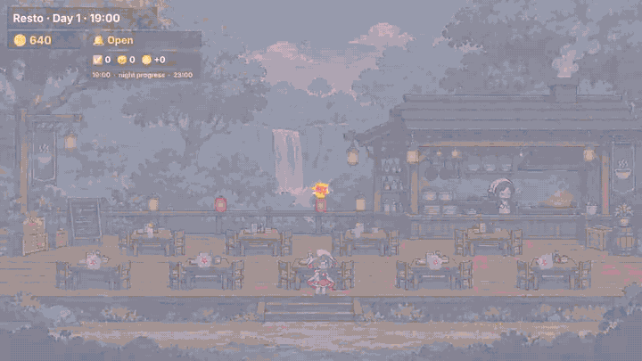
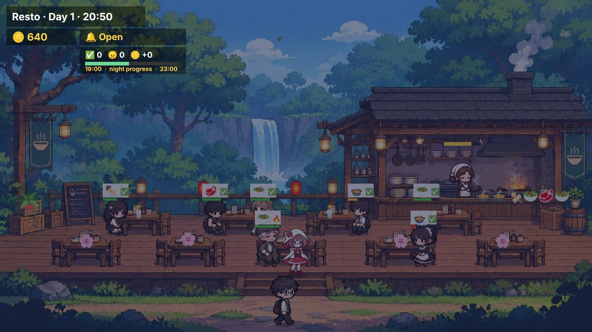
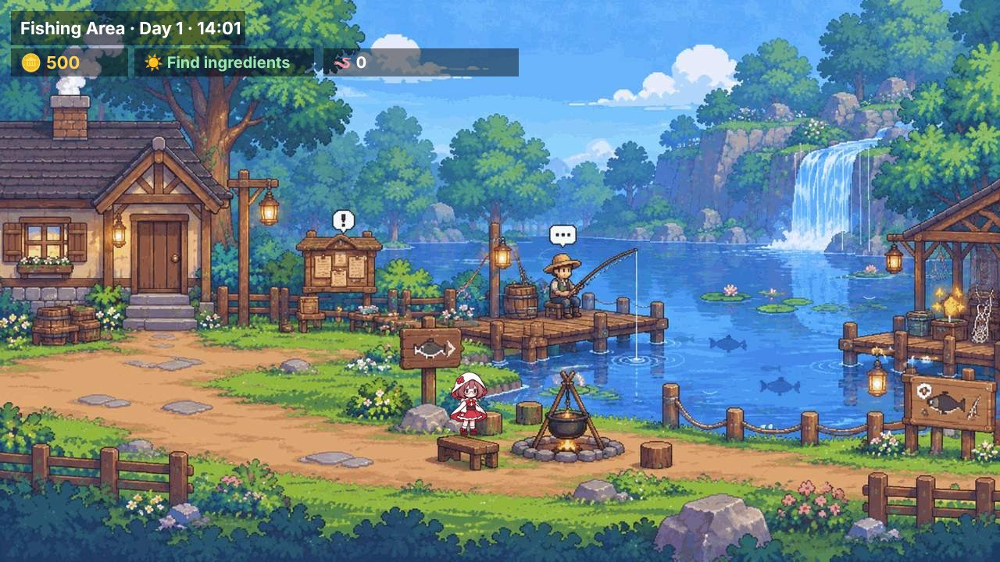
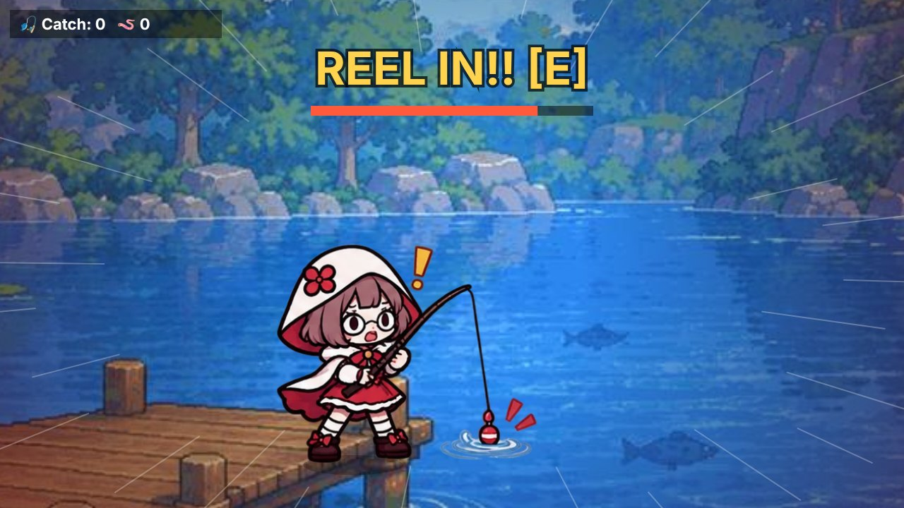
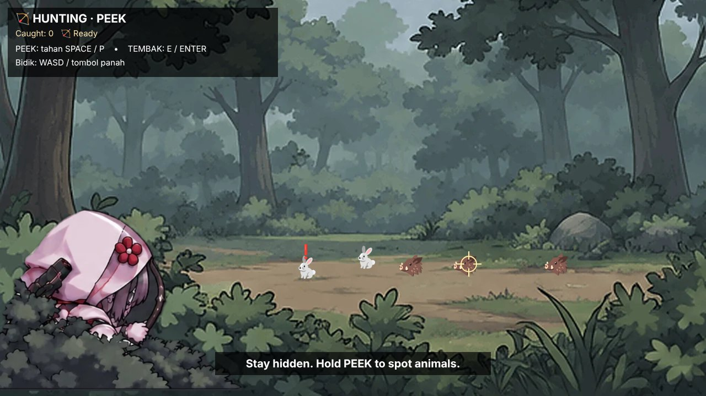
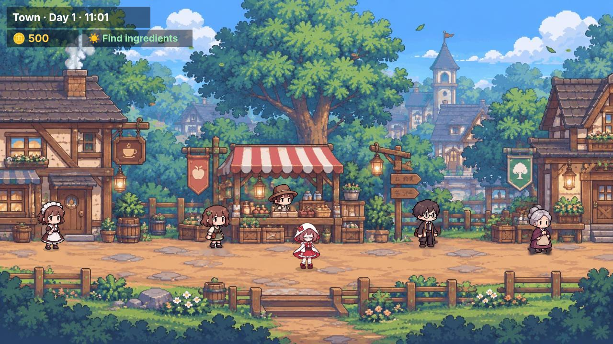
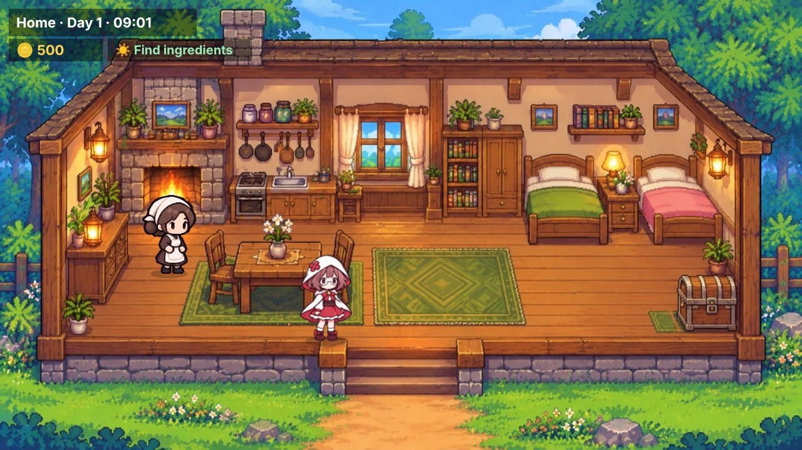
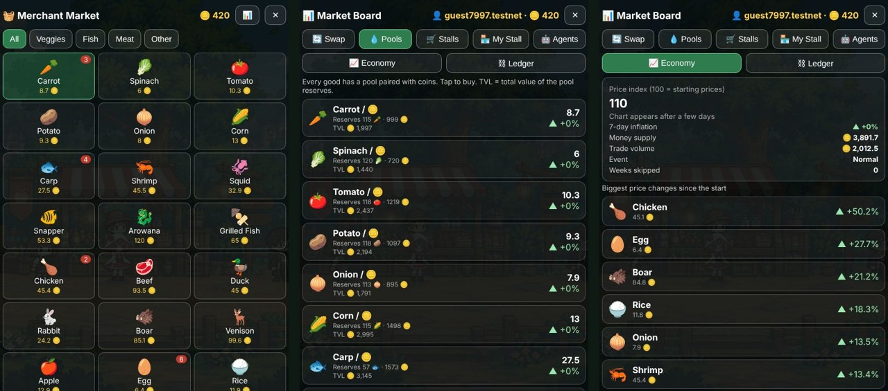

<p align="center">
  
</p>

<h1 align="center">Cozy Hood Trails</h1>

<p align="center">
  <b>Fish, hunt and forage by day. Cook and serve a packed restaurant by night.</b><br>
  A cozy life sim with a living market, playable right in your browser.
</p>

<p align="center">
  <a href="https://valenciayuna.github.io/cozy-hood-trails/"></a>
</p>

<p align="center">
  
  
  
  
</p>

<p align="center">
  
</p>

A fishing, hunting and foraging life sim with a restaurant and a market whose prices move on every
trade. The goods ledger is an NEP-245 contract deployed on NEAR testnet (play money, no real-world
value). One HTML file, no install, runs on desktop and phone.

**Play:** https://valenciayuna.github.io/cozy-hood-trails/

## What this is, and the problem it solves

Most cozy sims have a fake market: prices are constants and the shop's money comes from nowhere.
This one gives all 22 goods a small real market — each good has its own coin pool, prices move on every
trade, and the shopkeepers are agents with their own wallets that restock, undercut each other and
arbitrage. You gather by day and run a restaurant by night, so the money the restaurant earns is the
money the market charges you tomorrow.

## NEAR HACKATHON submission

- **Track:** `games` — Games With Real Economies
- **Repository:** https://github.com/valenciayuna/cozy-hood-trails (public, MIT)
- **Demo:** posted on X with the demo video, tagged @NEARProtocol and #NEARHackathon
- **Sibling entry:** [Q-DAY](https://github.com/valenciayuna/q-day), an independent project in its own
  repo with no shared code; its README names this one in return (Q-015)

What NEAR does here, concretely:

- the goods ledger is a NEP-245 multi-token contract on testnet
  (`rumah-resto-market-5959.testnet`), deployed and funded, exposing `mt_transfer`,
  `mt_batch_transfer`, `mt_balance_of`, `mt_batch_balance_of`, `mt_tokens_for_owner`, `mt_supply`,
  `recent(n)` and a backend-signed `settle(from, to, token_id, amount)`;
- every market agent is a wallet (`sari.testnet`, `bayu.testnet`, `joko.testnet` and an escrow), so the
  economy is meant to settle between accounts instead of inside a database;
- trades are recorded as intents (`intent_swap` with `token_in`, `token_out`, `amount_in`, `solver`), a
  shape a solver can route later;
- sign-in is a one-click guest identity: no wallet extension, no seed phrase, no key in the browser.

One line of status: the contract and the relayer are live, settlement is **not enabled in this build**
(the section below says why), so the market you play against runs in the browser. This track is judged
on the game loop, not the token.

### Baseline and what was built during the window (Q-001, Q-003, Q-004)

The first commit in this repository is 2026-11-09, inside the hackathon window (the window opened
2026-10-19), so there is no pre-hackathon baseline to separate out: every commit here is hackathon
work. `git log --reverse` starts at `3e35c60`.

### Libraries and disclosure (Q-005)

- No framework, no template, no UI kit. `index.html` is hand-written HTML/CSS/JS drawing to a canvas,
  with no external script tags and nothing fetched at runtime. Sound is generated with the Web Audio
  API (no audio files). Two images ship inside the HTML as data URIs: the menu illustration and an
  NPC sprite sheet; everything else on screen is drawn procedurally.
- Contract: `near-sdk` 5.30 and `borsh` 1.5. Nothing else.
- Built with AI coding assistants at the author's direction; the game design, art direction and
  economy tuning are the author's.

### Reproducing it (for screening)

"Run it locally" and "Try it in two minutes" above are the whole check: open the file, click Start,
swap one good four times and watch the pool reprice, skip a week, then read the contract from testnet
RPC. No install, no key, no wallet.

## A day in the hood

| | |
|---|---|
| **Morning to evening: gather** | Fish at the dock or the waterfall, sneak into the forest to hunt rabbits, hens, boar and deer, chat with the villagers, take quests from the board, and shop at the Merchant Market. |
| **18:00: Mama gets ready** | Mama heads to the restaurant to prep. Pick tonight's menu, learn recipes, and decorate. |
| **19:00 to 23:00: serve** | Hit **Open Restaurant**. Customers arrive in groups, order, and lose patience fast. Grab each dish from Mama and run it to the right table. The door queue gets heavier as the night runs, last call is 22:40, and quick service earns tips. A full
night takes about 2 minutes. |
| **23:00: shift done** | Collect the night's earnings, tips and a star rating, then head home. Mama tucks you in and sends you to bed. |

## Screenshots

<table>
  <tr>
    <td width="50%"><br><sub><b>Rush hour:</b> every table has an order, Mama is cooking, you are running plates.</sub></td>
    <td width="50%"><br><sub><b>Fishing village:</b> quest board, bait shop, campfire and the waterfall spot for rare fish.</sub></td>
  </tr>
  <tr>
    <td><br><sub><b>Fishing:</b> wait for the sign, then reel in before it gets away.</sub></td>
    <td><br><sub><b>Hunting:</b> stay hidden, peek to spot animals, and take your shot.</sub></td>
  </tr>
  <tr>
    <td><br><sub><b>Town:</b> five villagers and the Merchant Market.</sub></td>
    <td><br><sub><b>Home:</b> Mama, a storage chest and a warm bed.</sub></td>
  </tr>
  <tr>
    <td><br><sub><b>READY, GO!</b> The night begins.</sub></td>
    <td><br><sub><b>Shift done!</b> Time for a well-earned rest.</sub></td>
  </tr>
</table>

<p align="center">
  <br>
  <sub><b>Market Board:</b> a DEX-style swap, liquidity pools for every good, and live economy stats.</sub>
</p>

## Try it in two minutes

1. Open the game and click **Start**. A `guestNNNN.testnet` identity appears with the starting basket:
   500 coin, 3 wortel, 2 ikan mas, 6 telur.
2. Click **MARKET** -> **swap**, pick `wortel`, enter `20`, press the swap button. Do it four times and
   watch the quoted cost rise (16.4 -> 16.9 -> 17.5 -> 18.1 coin on a fresh guest save): the pool reprices on
   every trade.
3. Press **+1 WEEK**. The weekly report shows new prices, the events that fired and what each agent
   earned.
4. Click **LEDGER** to read the deployed contract from testnet RPC (`rumah-resto-market-5959.testnet`).
5. Play a day: gather, then open the restaurant at 19:00 and serve until 23:00. Sleeping saves the day;
   close the tab and reopen to see it kept.

## Features

- **Restaurant sim.** 4 menu slots, 10 dishes (2 free staples plus 8 learnable recipes), table decor, order timers, tips, a nightly summary and a star rating. Customers come in waves, fill tables and queue at the door when the place is full.
- **Fishing.** Cast, wait, reel in. Bait raises rare-fish odds, and the waterfall spot is the best place for arowana. Grill your catch at the campfire and serve it at the restaurant.
- **Hunting.** Hide, peek and shoot at rabbits, hens, boar and deer. The animals get spooked if you stay exposed too long or miss.
- **A real little economy.** 22 goods, each with its own coin pool and a 0.3% fee. Prices move with every trade, goods-to-goods swaps route through two pools, and random events (bumper harvest, drought, sea storm, livestock plague, village festival, trade ship) shake things up.
- **Market agents.** Bu Sari, Pak Bayu, Pak Joko and friends produce, shop, list stalls and arbitrage on their own wallets. Put your own goods on a stall and see who buys.
- **Fast mode.** `+1 HOUR`, `18:00` and `+1 WEEK` skip ahead, and the weekly report shows price changes, events and how each agent did.
- **Day and night.** The world darkens at dusk, Mama has her own daily routine, and your progress saves in the browser.
- **Fully synthesized audio.** The menu, town, lake, forest and restaurant music, the sound effects and even the villagers' voices are generated live with the Web Audio API. There are no audio files.

## Controls

| Action | Keyboard | Phone |
|---|---|---|
| Move | `A` `D` or arrow keys (`W` `S` to move up and down where there is depth) | on-screen pad |
| Interact, talk, serve | `E`, `Space` or `Enter` | `E` button |
| Skip one hour | `T` | `+1 HOUR` |
| Market Board | `M` | `MARKET` |
| Hunting: peek | hold `Space` or `P` | `PEEK` |
| Hunting: aim and shoot | `W` `A` `S` `D` or arrows to aim, `E` or `Enter` to shoot | on-screen pad and `E` |
| Fishing: cast and reel | `E` | `E` button |
| Leave a minigame | `Esc` | `DONE` / `END HUNT` |

## Run it locally

No build step. Open `index.html` in a browser, or serve the folder:

```bash
python3 -m http.server 8000
# then open http://localhost:8000
```

Every market trade runs on the local AMM. Settlement is designed to post to the relayer, and until the
session handshake is added the game stays on its local simulation, so a dead or refusing endpoint
never blocks play.

## Sign in, get a wallet

Sign in as a guest. That is the only path in this build: there is no OAuth, and the Google and X
plates on the menu picture are placeholders that sign you in as a guest too. The menu says so, and so
does the sign-in panel.

Signing in mints a local player identity, something like `guest3058.testnet`, and a starting basket of
500 coin, 3 wortel, 2 ikan mas and 6 telur. The identity and the save live in `localStorage`: reloading keeps the same player, and
clearing site data or using incognito gives you a new one.

The identity is not a keyed NEAR account and cannot be exported or funded. In this build the balances
you trade against are held in the browser; the on-chain contract is the ledger the goods are meant to
settle against (see the status below).

## What is on chain

| piece | where it lives | status |
|---|---|---|
| item ledger | `rumah-resto-market-5959.testnet`, NEP-245 multi-token | deployed and funded on testnet |
| market agents | Bu Sari, Pak Bayu, Pak Joko, market escrow | wallets listed by the relayer |
| your wallet | browser identity (`guestNNNN.testnet`) + local save | local to this build |
| trades | AMM pools in the browser, 0.3% fee, price moves per trade | simulated locally |
| settlement | `settle` / `mt_transfer` through the relayer | **not enabled in this build** |
| fast mode | `+1 HOUR`, `18:00`, `+1 WEEK` compress months into minutes | works locally |

Click **LEDGER** in game to read the contract's live state from testnet RPC.

Why settlement is off: the relayer is running (`GET /health` returns the contract, the two allowed
methods, the agent wallets and the session count), but it only signs a trade that carries a session
token, and this build does not request one, so every settlement POST comes back
`401 {"ok":false,"error":"no session"}`. The game keeps playing on its local simulation by design; the
trade log in game (`intent_swap`, `social_login`) records exactly what would have been sent.

## How settlement is guarded

The browser never holds a key. It is built to post `{from, to, token, amount, session}` to the
relayer, which signs `settle` with a function-call key restricted to `settle` and `mt_transfer` on
this contract. The session step is the one missing in this build (see the status table above).

Three rules stop the endpoint from being a tap into the agents' money:

- a request must carry a valid session token
- your own wallet has to be one side of the trade
- the other side must be an agent wallet, and agent-to-agent trades are refused

So a crafted request like `{from: sari.testnet, to: me}` comes back `403 not your wallet`, and the
relayer key cannot mint, so it cannot inflate supply.

Where goods come from: Bu Sari stocks produce, Pak Bayu stocks fish, Pak Joko stocks meat and
staples. A purchase moves coin to the market wallet and the goods from whichever agent actually
holds them.

## Honest scope

Everything you trade in this build is simulated in the browser: the AMM pools, the agent wallets and
the prices all live in the local save, and nothing is written to the ledger contract yet. What is on
chain today is the deployed NEP-245 contract and its agent wallets.

Gathered goods are local too: fish you catch and crops you pick live in the browser's save.

There is no per-player NEAR account, no wallet connect and no withdrawal. Supply changes only through
trades, never through minting.

## Contract

`rumah-resto-market-5959.testnet` implements NEP-245 multi-token: `mt_mint` (owner only),
`mt_transfer`, `mt_batch_transfer`, `mt_balance_of`, `mt_batch_balance_of`, `mt_tokens_for_owner`,
`mt_supply`, `recent(n)` and `settle(from, to, token_id, amount)` for backend-signed trades.

## Credits

Built for a hackathon by [valenciayuna](https://github.com/valenciayuna). This is one of two independent entries by the same builder. The other is [Q-DAY](https://github.com/valenciayuna/q-day), a post-quantum beat 'em up. Different repos, different builds, no shared code.
