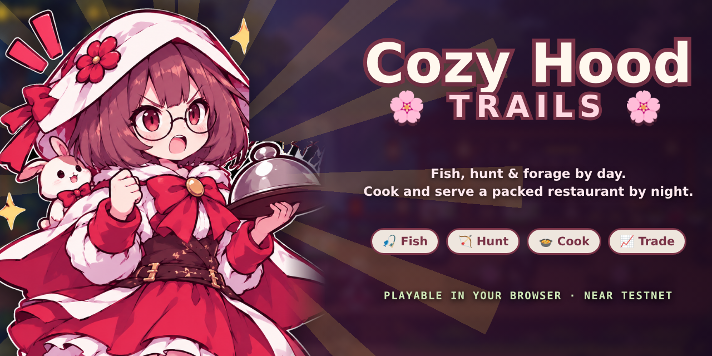
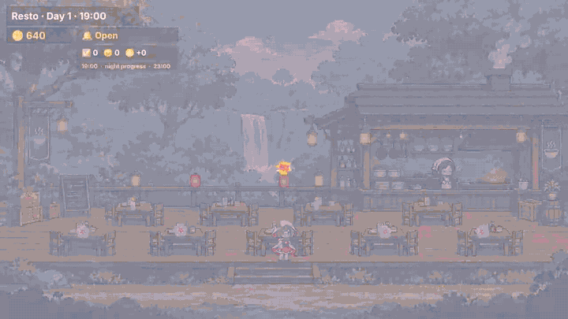
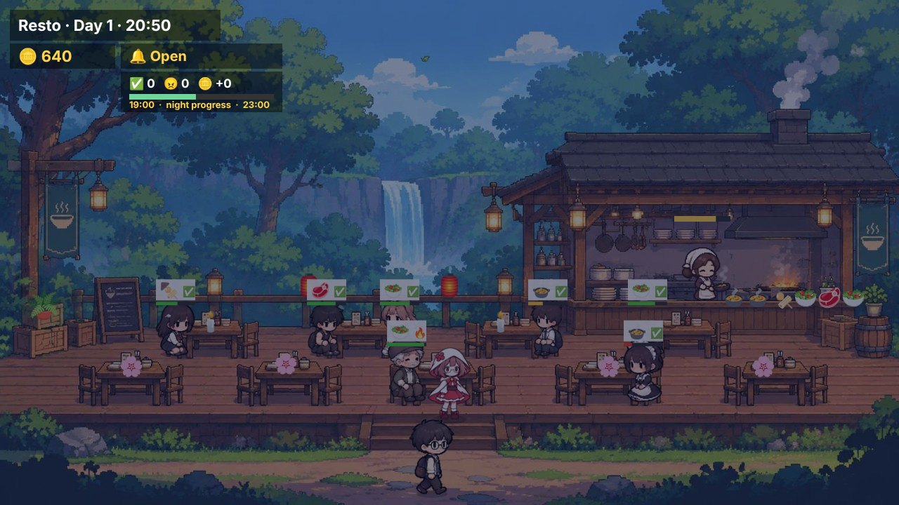
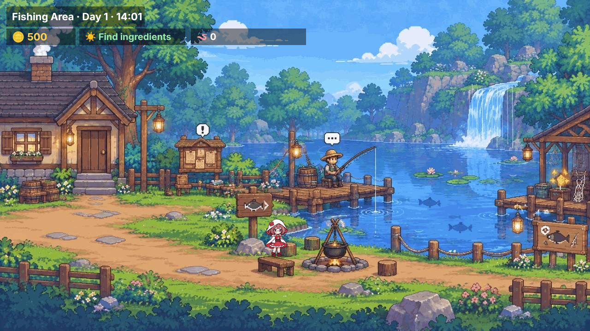
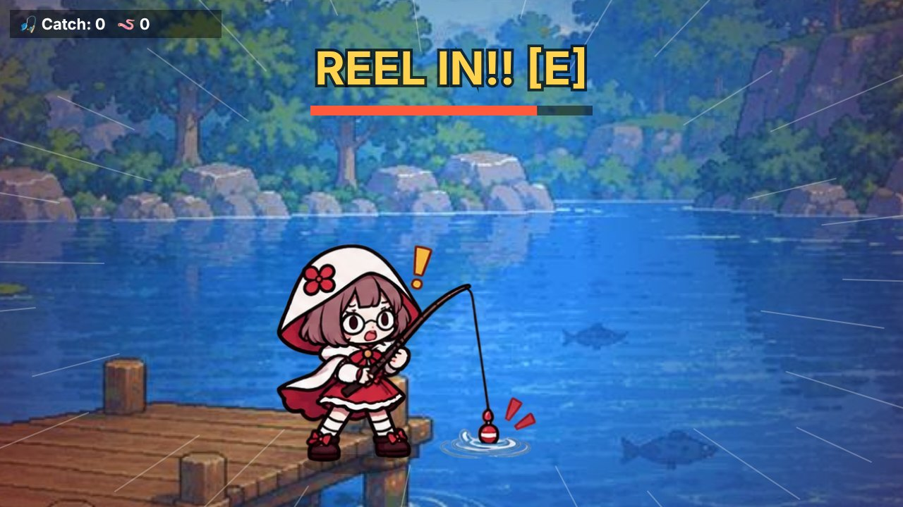
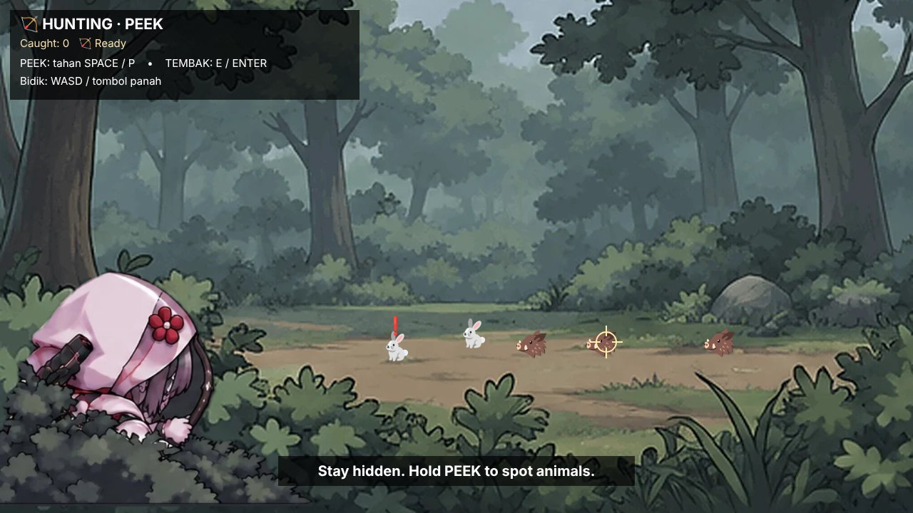
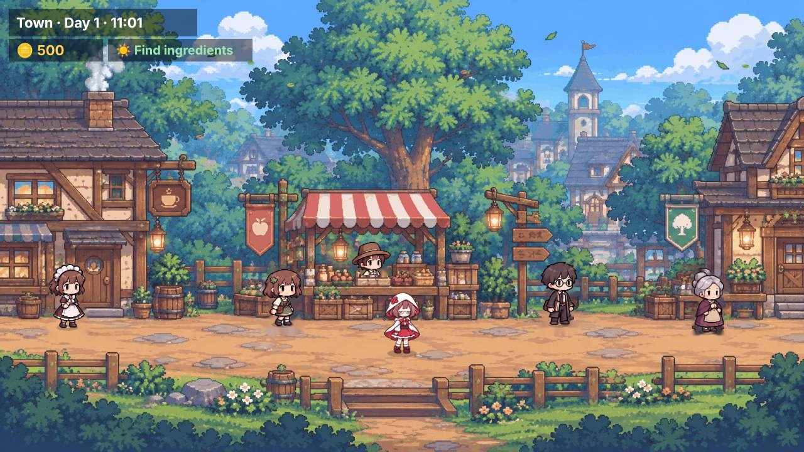
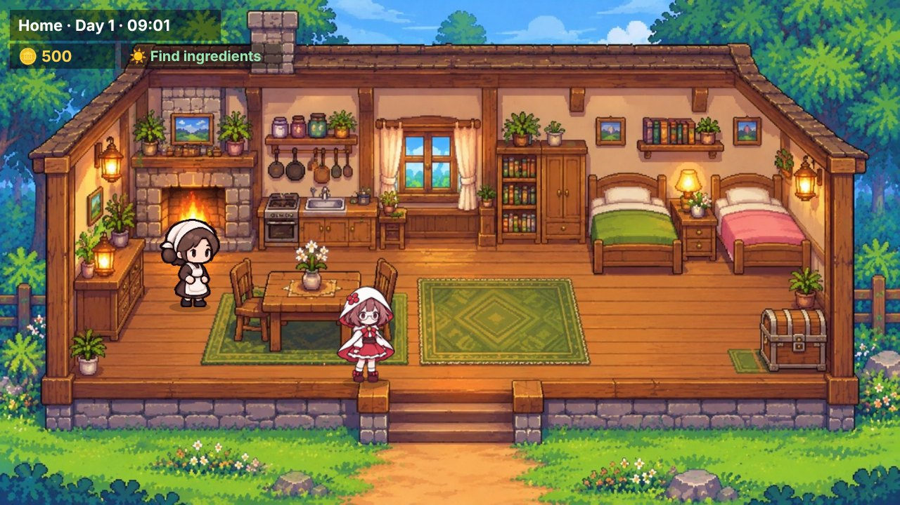
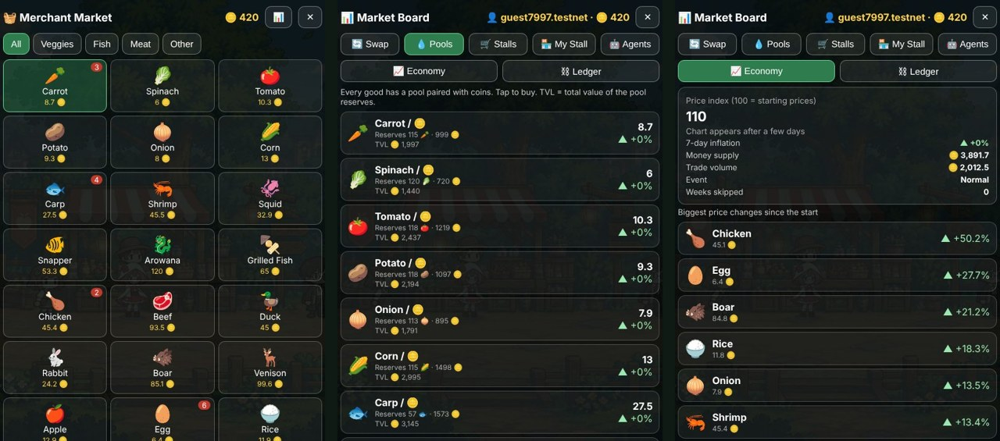

<p align="center">
  
</p>

<h1 align="center">Cozy Hood Trails</h1>

<p align="center">
  <b>Fish and hunt by day. Cook and serve a packed restaurant by night.</b><br>
  A cozy life sim with a locally simulated market, playable right in your browser.
</p>

<p align="center">
  <a href="https://valenciayuna.github.io/cozy-hood-trails/"></a>
</p>

<p align="center">
  
  
  
  
</p>

<p align="center">
  
</p>

Play as a fisher and hunter by day, then run a restaurant by night. This prototype explores how a changing market can add choices to a cozy life sim. The market simulation runs locally in the browser; the separate NEAR testnet ledger panel is read-only in this build.

**Play:** https://valenciayuna.github.io/cozy-hood-trails/

## What this is, and what NEAR does

Cozy Hood Trails is a browser life-sim prototype with fishing, hunting, restaurant management, and a simulated 22-good market. Prices and NPC trading activity change as the local simulation runs.

The market is **not an on-chain economy** in this build:

| Feature | Actual implementation |
|---|---|
| Market pools, prices, NPC behavior, player inventory and trades | Local JavaScript simulation; saved in the browser with `localStorage` |
| Guest identity | Local label stored by the game; not a NEAR account, wallet, or social login |
| Market activity log | Local simulation log; method names such as `mt_transfer` do not themselves prove a chain transaction |
| NEAR item ledger | Separate deployed testnet contract at `rumah-resto-market-5959.testnet`; the in-game LEDGER panel reads contract state over testnet RPC |
| Game-to-contract market settlement | Not verified in this build; local trades complete independently of any relay response, so a request or log entry is not proof of settlement |

The contract and its testnet state are a real NEAR component. The game reads its ledger state and also contains a relay request/response path for market-related events, but no successful game-triggered settlement has been verified. Ledger balances/history are separate from the browser's simulated market and player save. No claim is made here that NPCs or players control on-chain wallets, or that gameplay trades settle on-chain.

## NEAR HACKATHON submission

- **Track submitted:** `games` — Games With Real Economies. The market/economy gameplay is a local prototype, not a live on-chain game economy.
- **Repository:** https://github.com/valenciayuna/cozy-hood-trails (public, MIT)
- **Demo:** [Watch the gameplay video on X](https://x.com/nauvalennn/status/2121880825725915193) (187 seconds; includes the public game link)
- **Sibling entry:** [Q-DAY](https://github.com/valenciayuna/q-day), an independent project in its own repo with no shared code; its README names this one in return (Q-015)

### Baseline and what was built during the window (Q-001, Q-003, Q-004)

The first commit in this repository dates to 2026-11-09, within the hackathon window (which opened
2026-10-19), so there is no pre-hackathon baseline to compare against: every commit here is hackathon
work. `git log --reverse` starts at `3e35c60`.

### Libraries and disclosure (Q-005)

- No framework, template, or UI kit. `index.html` is hand-written HTML/CSS/JS rendered on a canvas;
  it has no external script tags and fetches nothing at runtime. Sound is generated with the Web Audio
  API (no audio files). Two images are embedded in the HTML as data URIs: the menu illustration and
  an NPC sprite sheet. Everything else on screen is drawn procedurally.
- Contract: `near-sdk` 5.30 and `borsh` 1.5. Nothing else.
- Built with AI coding assistants at the author's direction; the game design, art direction and
  economy tuning are the author's.

### Reproducing it (for screening)

"Run it locally" and "Try it in two minutes" above are the full screening walkthrough: open the file,
click Start, swap the same good four times and watch its pool price change, advance one week, then
read the contract through the testnet RPC. No installation, key, or wallet is needed.

## A day in the hood

| Time | What happens |
|---|---|
| **Morning to evening: fish and hunt** | Fish at the dock or waterfall, sneak into the forest to hunt rabbits, hens, boar, and deer, chat with villagers, take quests from the board, and shop at the Merchant Market. |
| **18:00: Mama gets ready** | Mama heads to the restaurant to prep. Choose tonight's menu, learn recipes, and decorate. |
| **19:00–23:00: serve** | Press **Open Restaurant**. Customers arrive in groups, place orders, and quickly lose patience. Pick up each dish from Mama and deliver it to the right table. The door queue grows as the night goes on; last call is at 22:40, and fast service earns tips. A full night takes about 2 minutes. |
| **23:00: shift ends** | Collect the night's earnings, tips, and star rating, then head home. Mama tucks you in for the night. |

## Screenshots

<table>
  <tr>
    <td width="50%"><br><sub><b>Rush hour:</b> every table has an order, Mama is cooking, you are running plates.</sub></td>
    <td width="50%"><br><sub><b>Fishing village:</b> quest board, bait shop, campfire and the waterfall spot for rare fish.</sub></td>
  </tr>
  <tr>
    <td><br><sub><b>Fishing:</b> wait for the sign, then reel in before it gets away.</sub></td>
    <td><br><sub><b>Hunting:</b> stay hidden, peek to spot animals, and take your shot.</sub></td>
  </tr>
  <tr>
    <td><br><sub><b>Town:</b> five villagers and the Merchant Market.</sub></td>
    <td><br><sub><b>Home:</b> Mama, a storage chest and a warm bed.</sub></td>
  </tr>
  <tr>
    <td><br><sub><b>READY, GO!</b> The night begins.</sub></td>
    <td><br><sub><b>Shift done!</b> Time for a well-earned rest.</sub></td>
  </tr>
</table>

<p align="center">
  <br>
  <sub><b>Market Board:</b> a DEX-style swap, liquidity pools for every good, and live economy stats.</sub>
</p>

## Try it in two minutes

1. Open the game and click **Start**. Your guest identity will look like `guestNNNN.testnet`, and
   your starting basket contains 500 coins, 3 carrots, 2 carp, and 6 eggs.
2. Click **MARKET** → **swap**, select `wortel` (carrots), enter `20`, and press the swap button. Repeat four
   times and watch the quoted cost rise (16.4 → 16.9 → 17.5 → 18.1 coins on a fresh guest save):
   the pool reprices after every trade.
3. Press **+1 WEEK**. The weekly report shows updated prices, triggered events, and each agent's
   earnings.
4. Click **LEDGER** to read the deployed contract from the NEAR testnet RPC
   (`rumah-resto-market-5959.testnet`).
5. Play a day: fish and hunt, then open the restaurant at 19:00 and serve until 23:00. Sleeping
   saves your progress; close and reopen the tab to check that it persists.

## Features

- **Restaurant sim.** 4 menu slots, 10 dishes (2 free staples and 8 recipes to learn), table decor, order timers, tips, a nightly summary, and a star rating. Customers arrive in waves, fill tables, and queue at the door when the restaurant is full.
- **Fishing.** Cast, wait, and reel in your catch. Bait improves your odds of finding rare fish, and the waterfall is the best spot for arowana. Grill your catch at the campfire and serve it at the restaurant.
- **Hunting.** Hide, peek, and shoot rabbits, hens, boar, and deer. Stay exposed too long or miss a shot, and the animals will be spooked.
- **A real little economy.** 22 goods, each with its own coin pool and a 0.3% fee. Prices change with every trade, goods-to-goods swaps route through two pools, and random events (bumper harvest, drought, sea storm, livestock plague, village festival, and trade ship) shake things up.
- **Market agents.** Bu Sari, Pak Bayu, Pak Joko, and others produce goods, shop, list items at stalls, and arbitrage using their own wallets. Put your goods up for sale and see who buys them.
- **Fast mode.** Use `+1 HOUR`, `18:00`, and `+1 WEEK` to skip ahead. The weekly report shows price changes, events, and how each agent did.
- **Day and night.** The world darkens at dusk, Mama follows her own daily routine, and your progress is saved in your browser.
- **Fully synthesized audio.** Music for the menu, town, lake, forest, and restaurant, along with sound effects and villagers' voices, is generated live with the Web Audio API. No audio files are used.

## Controls

The game supports keyboard controls on PC and an on-screen pad on phones. You don't need a mouse,
but the on-screen buttons can be clicked too.

### PC (keyboard)

|| Action | Keys |
||---|---|
|| Walk left / right | `A` / `D`, or `←` / `→` |
|| Walk up / down a depth lane (town, house, restaurant floor) | `W` / `S`, or `↑` / `↓` |
|| Interact: talk, open a door, pick up an item, grab a dish, or serve a plate | `E`, `Space`, or `Enter` |
|| Skip one hour | `T` |
|| Jump to 18:00 (Mama starts prepping) | The `18:00` button |
|| Jump ahead one week (market report) | The `+1 WEEK` button |
|| Open / close the Market Board | `M` |
|| Close a panel, or exit fishing or hunting | `Esc` |
|| Fishing: cast, then reel in when ❗ appears | `E` |
|| Hunting: stay hidden / peek out | Hold `Space` or `P` |
|| Hunting: aim | `W`, `A`, `S`, `D`, or the arrow keys |
|| Hunting: shoot | `E` or `Enter` |
|| Mute all audio | The speaker button in the corner |

Movement is continuous while a key is held: keep `D` pressed to keep walking. During hunts, the same
keys steer your crosshair instead of moving your character.

### Phone

- The on-screen pad on the left: `◀ ▶` to walk, `▲ ▼` to change depth, and to aim while hunting.
- The `E` button: interact, cast, reel in, or shoot.
- Hold `PEEK` while hunting. Select `DONE` / `END HUNT` to exit a minigame.
- The HUD buttons `+1 HOUR`, `18:00`, `+1 WEEK`, `MARKET`, and the speaker button work the same as their keyboard controls.

## In development

This demo build does not yet include the following planned features:

| Planned | Status |
|---|---|
| Foraging mode (gather crops/berries in the forest) | not implemented |
| Mining | not implemented |
| Player lobby / multiplayer gathering | not implemented |
| Real wallet login (today: mock guest identity) | not implemented |
| On-chain settlement via the relayer | not enabled (see the status table above) |

## Run it locally

No build step is required. Open `index.html` in a browser, or serve the folder locally:

```bash
python3 -m http.server 8000
# then open http://localhost:8000
```

Every market action in this build updates the browser simulation. The visible market log records local events only; entries named `intent_swap` or `mt_transfer` are not chain transactions.

## Identity and saved game

Choose **Play as guest** to start. The game creates a local label such as `guest3058.testnet`; despite its suffix, this label is not a NEAR account. Player inventory, market balance and progress are stored in the browser's `localStorage`. Google and X buttons shown in the menu artwork are placeholders, not OAuth sign-in.

## NEAR ledger: separate panel

The **LEDGER** panel queries the deployed contract `rumah-resto-market-5959.testnet` over NEAR testnet RPC. The contract has token balances, total supplies and a transfer-history view. These are contract state and can be inspected independently of the game save.

| Area | Status in this build | Evidence / boundary |
|---|---|---|
| Contract deployment and ledger reads | Deployed; panel performs testnet RPC view calls | Contract account and view methods in `contract-src/lib.rs`; panel RPC calls in `index.html` |
| In-game pools, NPC activity, player balance and stalls | Local simulation | JavaScript state and `localStorage` in `index.html` |
| Game-triggered market settlement | Not verified in this build | Market actions update local state, while a relay request and response path exists; no successful game-triggered contract settlement was verified, so the path is not presented as working |
| Player wallet / social login | Not implemented | Guest label is local; no player key or OAuth flow |

A historical transfer in the ledger proves that the contract has recorded transfers; by itself, it does not prove a current game action caused that transfer. The README makes no claim that the currently playable market is on-chain.

## Honest scope

Cozy Hood Trails is a playable life-sim prototype whose changing market, NPC behavior and player economy are simulated in the browser. NEAR provides a separate testnet item ledger that the game can read; market trades in this build do not settle to it. There is no player-owned on-chain wallet or live game economy in this build.

## Contract source and tests

The Rust source is `contract-src/lib.rs` and the manifest is `contract-src/Cargo.toml`. From `contract-src/`, run:

```sh
cargo test
```

The contract exposes `mt_mint` (owner-only), `mt_transfer`, `mt_batch_transfer`, balance and supply views, `recent(n)`, and owner-authorized `settle(from, to, token_id, amount)`. It uses NEP-245-style method names; this README does not claim full standard conformance or an audit.

## Credits

Built for a hackathon by [valenciayuna](https://github.com/valenciayuna). This is one of two independent entries by the same creator. The other is [Q-DAY](https://github.com/valenciayuna/q-day), a post-quantum beat 'em up. The projects have separate repositories and builds, with no shared code.
